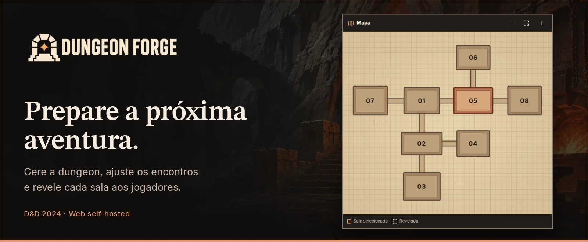
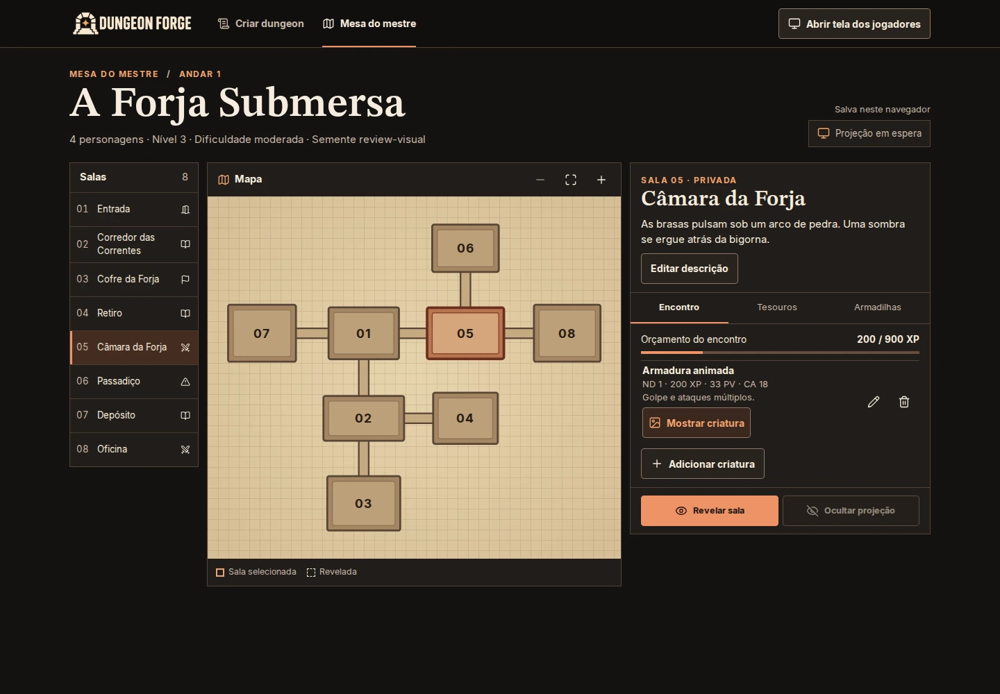
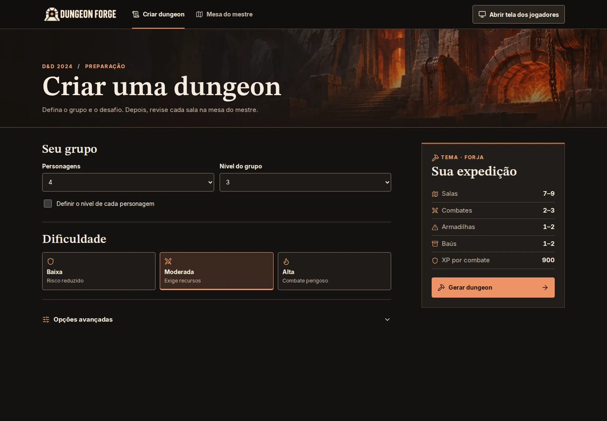
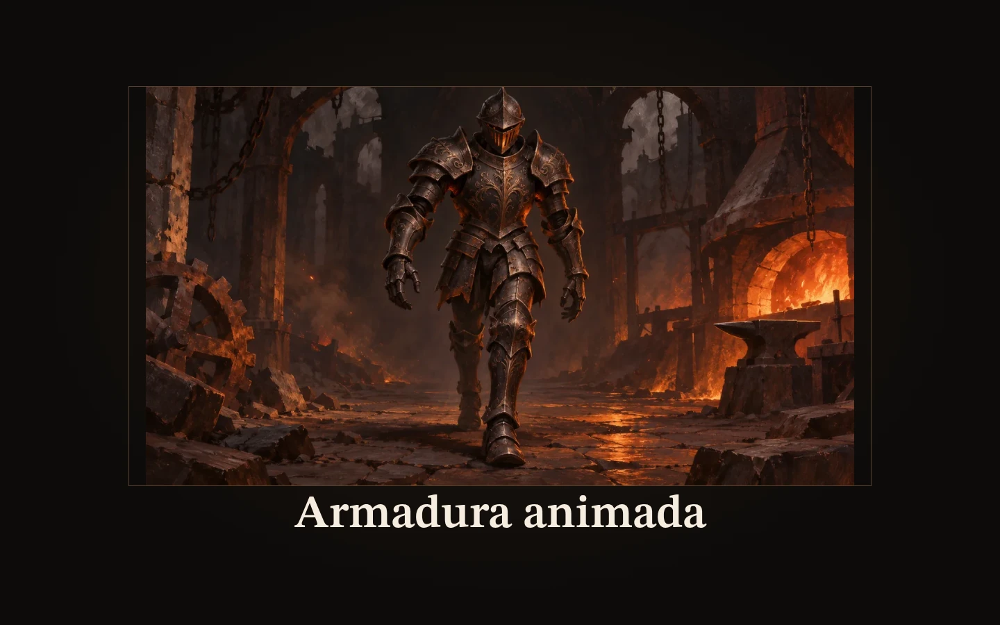

# Dungeon Forge

<p>
  
</p>

Prepare uma dungeon para sua mesa de D&D 2024. Defina o grupo e o desafio, gere a Forja Submersa, ajuste cada sala e mostre aos jogadores o que o mestre revelar.

O MVP roda no navegador e pode ser hospedado no seu computador ou servidor. O mapa, os encontros, as armadilhas e os tesouros são gerados a partir das configurações da expedição. As ilustrações, fontes e ícones acompanham a aplicação.

[Rodar localmente](#rodar-localmente) · [Ver as telas](#telas) · [Como funciona](#como-funciona) · [Hospedar](#hospedar)

## Telas

**Mesa do mestre**

Lista de salas, mapa SVG e painel de edição ficam lado a lado. O mestre acompanha o orçamento de XP e controla a projeção para os jogadores.



<details>
  <summary>Ver a criação da dungeon e a tela dos jogadores</summary>

  <p><strong>Criar dungeon</strong></p>
  <p>Configure personagens, níveis e dificuldade. O resumo mostra a estimativa de salas, combates, armadilhas, baús e XP por combate.</p>
  

  <p><strong>Tela dos jogadores</strong></p>
  <p>Ao mostrar uma criatura, a janela pública apresenta a ilustração e o nome. Fichas e estatísticas ficam na mesa do mestre.</p>
  
</details>

As capturas mostram o MVP em execução, com a semente `review-visual` e uma armadura animada adicionada pela edição do encontro.

## Como funciona

1. **Configure a expedição.** Informe de 2 a 8 personagens, com nível comum ou níveis individuais de 1 a 20. Escolha a dificuldade. Nas opções avançadas, ajuste o tamanho, a preferência de chefão e a semente.
2. **Gere a dungeon.** O app monta salas conectadas e distribui encontros, armadilhas e baús. A mesma semente reproduz a planta e o conteúdo com os mesmos parâmetros e versão do catálogo.
3. **Revise cada sala.** Navegue pela lista ou pelo mapa. Adicione ou personalize criaturas, baús, moedas e armadilhas. Edite a descrição pública. O orçamento de XP acompanha as mudanças, e o mestre pode confirmar um encontro acima do orçamento.
4. **Conduza a sessão.** Use **Mostrar criatura** para abrir sua imagem e nome público na janela dos jogadores. Use **Revelar sala** para exibir a descrição e o recorte do mapa com as salas reveladas. **Ocultar projeção** volta à tela de espera.

Em **Personalizar criatura**, o mestre também pode definir um nome público e carregar uma ilustração local. Uma criatura sem imagem é apresentada pelo nome.

A janela dos jogadores funciona como uma segunda tela do mestre. Arraste-a para outro monitor ou projetor. Se o navegador bloquear a abertura, permita pop-ups deste site e use **Abrir tela dos jogadores**.

### Salvamento

A aplicação mantém uma dungeon por origem no armazenamento do navegador. As edições são salvas no dispositivo em uso, e gerar outra dungeon pede confirmação para substituir a atual. Limpar os dados do site apaga essa cópia.

### Catálogo e regras

O catálogo inicial contém nove fichas resumidas e quatro retratos originais, com regras adaptadas do SRD 5.2.1 de D&D 2024. Os orçamentos consideram o nível e a quantidade de personagens. O mestre pode editar o resultado para adequar a sessão ao grupo.

## Rodar localmente

Você precisa de Git, Node.js com npm e Python 3. O script `npm start` usa o servidor HTTP do Python para servir a pasta `public/`.

```sh
git clone https://github.com/rfsants001/dungeon-forge.git
cd dungeon-forge
npm start
```

Abra [http://127.0.0.1:8080](http://127.0.0.1:8080) no navegador. Para encerrar o servidor, pressione `Ctrl+C` no terminal.

### Scripts do projeto

| Comando | O que faz |
| --- | --- |
| `npm start` | Serve `public/` em `127.0.0.1:8080` usando Python 3. |
| `npm test` | Executa a suíte de testes com `node --test`. |

O aplicativo usa módulos JavaScript nativos e arquivos estáticos, com execução direta pelo servidor HTTP.

## Hospedar

Sirva o conteúdo de `public/` com seu servidor HTTP ou use o Dockerfile do projeto.

```sh
docker build -t dungeon-forge .
docker run --rm -p 127.0.0.1:8080:80 dungeon-forge
```

Abra [http://127.0.0.1:8080](http://127.0.0.1:8080). Esse comando publica o app no próprio computador. Para disponibilizá-lo na rede, configure o endereço de escuta e o proxy do seu ambiente.

## Tecnologias e validação

A interface usa HTML, CSS, JavaScript com ES Modules e mapa SVG. O salvamento usa o armazenamento do navegador, e a projeção se comunica com a janela dos jogadores pela mesma origem.

A suíte cobre orçamento de XP, distribuição, conectividade do mapa, sementes, chefões e dados enviados para a janela pública, incluindo diferentes tamanhos de grupo e níveis.

```sh
npm test
```

A revisão visual foi executada no Chromium em 320, 390, 768, 1024 e 1440 px, com texto a 100% e 200%. Criar e Mesa passaram sem rolagem horizontal, incluindo oito níveis individuais. Com zoom máximo, o mapa reenquadrou as oito salas durante a navegação com Tab nas cinco larguras.

## Próximas etapas

- Importação de criaturas e itens pela D&D 5e SRD API.
- Backups e instalação como PWA.
- Sala do mestre com entrada por QR code e publicação de cenas nos celulares dos jogadores.
- Versão desktop e ambientações procedurais por tema.

## Licença e créditos

O código é distribuído sob a [licença MIT](LICENSE).

Dados de regras e fichas resumidas adaptados do *System Reference Document 5.2.1* da Wizards of the Coast LLC, distribuído sob CC BY 4.0. A seleção, as traduções, os resumos e as regras de geração são adaptações para este projeto. [SRD 5.2.1](https://www.dndbeyond.com/srd) · [CC BY 4.0](https://creativecommons.org/licenses/by/4.0/)

Ícones Lucide e fontes Inter e STIX Two Text, com seus avisos de licença em `public/assets/`. Logo e ilustrações originais geradas com o ImageGen integrado. O banner combina esses assets com uma captura do mapa do aplicativo.
